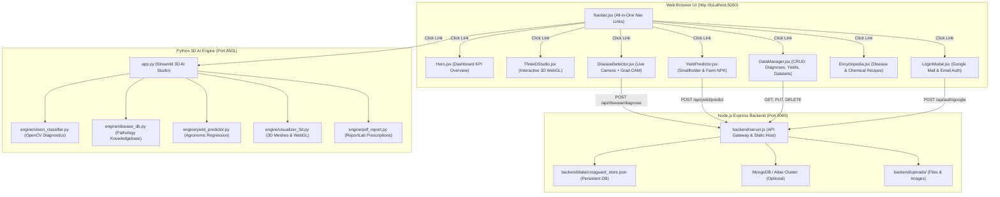

# 🌿 CropGuard AI — Interconnected Project Architecture

This document describes the unified layout of the **CropGuard AI Full-Stack Platform** and how every file connects to every other file across the React Frontend, Express Backend, MongoDB, and Python ML engines.

---

## 🗺️ System Interconnection Diagram

---

## 🔗 How Every File Connects to Each Other

### 1. User Interface Navigation (`frontend/src/`)
| Component File | Connects To | Trigger / Action |
| :--- | :--- | :--- |
| [`Navbar.jsx`](file:///C:/Users/hp/.gemini/antigravity/scratch/cropguard/frontend/src/components/Navbar.jsx) | All Sections & Modals | Sticky top navigation bar. Clicking any item jumps to `#overview`, `#threed-studio`, `#disease-detector`, `#yield-predictor`, `#data-manager`, `#encyclopedia`, or opens [`LoginModal.jsx`](file:///C:/Users/hp/.gemini/antigravity/scratch/cropguard/frontend/src/components/LoginModal.jsx). Also features a direct bridge link to the Streamlit 3D app at `http://localhost:8501`. |
| [`LoginModal.jsx`](file:///C:/Users/hp/.gemini/antigravity/scratch/cropguard/frontend/src/components/LoginModal.jsx) | [`services/api.js`](file:///C:/Users/hp/.gemini/antigravity/scratch/cropguard/frontend/src/services/api.js) ➔ `/api/auth/google` | Triggered by clicking **"Sign In / Google"** in Navbar or Hero. Authenticates with Google Mail or email, stores user identity in `localStorage`, and tags all saved farm records with the user's email. |
| [`ThreeDStudio.jsx`](file:///C:/Users/hp/.gemini/antigravity/scratch/cropguard/frontend/src/components/ThreeDStudio.jsx) | Pure HTML5 WebGL Canvas | Accessible via `#threed-studio`. Interactive 3D viewport allowing growers to orbit 360°, zoom in/out, toggle wireframe mesh, and inspect physical tissue depth (crater collapse vs. rust pustule peaks). |
| [`DiseaseDetector.jsx`](file:///C:/Users/hp/.gemini/antigravity/scratch/cropguard/frontend/src/components/DiseaseDetector.jsx) | [`services/api.js`](file:///C:/Users/hp/.gemini/antigravity/scratch/cropguard/frontend/src/services/api.js) ➔ `/api/disease/diagnose` | Accessible via `#disease-detector`. Connects to your webcam via WebRTC (`getUserMedia`), captures live leaf frames, displays Grad-CAM heatmaps, and sends images to the backend to be diagnosed and logged. |
| [`YieldPredictor.jsx`](file:///C:/Users/hp/.gemini/antigravity/scratch/cropguard/frontend/src/components/YieldPredictor.jsx) | [`services/api.js`](file:///C:/Users/hp/.gemini/antigravity/scratch/cropguard/frontend/src/services/api.js) ➔ `/api/yield/predict` | Accessible via `#yield-predictor`. Includes smallholder toggle (0.05 to 2.0 acres) with output in **Kilograms (Kg)** and **Tons**. Clicking **"Save Projection"** saves the record into the database. |
| [`DataManager.jsx`](file:///C:/Users/hp/.gemini/antigravity/scratch/cropguard/frontend/src/components/DataManager.jsx) | [`services/api.js`](file:///C:/Users/hp/.gemini/antigravity/scratch/cropguard/frontend/src/services/api.js) ➔ CRUD Endpoints | Accessible via `#data-manager`. Allows full **CREATE**, **READ**, **UPDATE** (edit field notes, actual harvest kg), and **DELETE** on diagnoses, yields, and dataset files. |
| [`Encyclopedia.jsx`](file:///C:/Users/hp/.gemini/antigravity/scratch/cropguard/frontend/src/components/Encyclopedia.jsx) | Local Knowledgebase | Accessible via `#encyclopedia`. Searchable guide across 8+ crops, active chemical ingredients, organic biocontrols, and cultural prevention steps with a 1-click **Print Guide** button. |

---

### 2. Backend & API Services (`backend/`)
| File | Connects To | Purpose |
| :--- | :--- | :--- |
| [`backend/server.js`](file:///C:/Users/hp/.gemini/antigravity/scratch/cropguard/backend/server.js) | React Frontend + Database | Serves the compiled React production frontend from `../frontend/dist` on port 5000 and exposes all REST API endpoints. |
| [`backend/data/cropguard_store.json`](file:///C:/Users/hp/.gemini/antigravity/scratch/cropguard/backend/data/cropguard_store.json) | Node.js Backend | Built-in zero-config persistent storage. Ensures user records, diagnoses, and datasets are saved permanently even without MongoDB installed. |

---

### 3. Python 3D AI Engine (`engine/` & `app.py`)
| File | Connects To | Purpose |
| :--- | :--- | :--- |
| [`app.py`](file:///C:/Users/hp/.gemini/antigravity/scratch/cropguard/app.py) | `engine/*.py` modules | Complete Streamlit 3D application running on port 8501 with real OpenCV computer vision, 3D Matplotlib response surfaces, and ReportLab PDF compilation. |
| [`engine/vision_classifier.py`](file:///C:/Users/hp/.gemini/antigravity/scratch/cropguard/engine/vision_classifier.py) | [`engine/disease_db.py`](file:///C:/Users/hp/.gemini/antigravity/scratch/cropguard/engine/disease_db.py) | Analyzes color-space tensors (HSV/LAB), generates thermal heatmaps, and classifies foliar pathologies. |
| [`engine/visualizer_3d.py`](file:///C:/Users/hp/.gemini/antigravity/scratch/cropguard/engine/visualizer_3d.py) | `matplotlib.mplot3d` | Generates 3D scientific elevation surface plots and WebGL topography JSON meshes. |
| [`engine/pdf_report.py`](file:///C:/Users/hp/.gemini/antigravity/scratch/cropguard/engine/pdf_report.py) | `reportlab` | Generates downloadable official Agronomic Health and Yield Prescription PDF certificates. |

---

## ⚡ How to Run Everything

### Option 1: 1-Click Launch Everything Together
Double-click [`start_all_together.bat`](file:///C:/Users/hp/.gemini/antigravity/scratch/cropguard/start_all_together.bat).
- Starts Express & React on **`http://localhost:5000`**
- Starts Streamlit 3D AI Studio on **`http://localhost:8501`**
- Both open automatically in your browser!

### Option 2: Run Full-Stack Web App Only
Double-click [`start_fullstack.bat`](file:///C:/Users/hp/.gemini/antigravity/scratch/cropguard/start_fullstack.bat).
- Opens **`http://localhost:5000`** with the full React + Express + MongoDB platform!

### Option 3: Run Streamlit 3D AI App Only
Double-click [`start_streamlit_3d.bat`](file:///C:/Users/hp/.gemini/antigravity/scratch/cropguard/start_streamlit_3d.bat).
- Opens **`http://localhost:8501`** with the Python 3D AI Studio!
