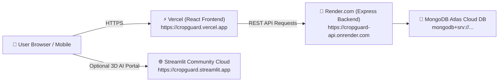

# 🚀 Line-by-Line Deployment Guide: Render.com & Vercel

This guide provides line-by-line, copy-paste instructions to deploy the **CropGuard Full-Stack Platform** to **Render** (Backend API + Database) and **Vercel** (React Frontend) for free 24/7 global web availability.

---

## 🏗️ Architecture Overview



---

## 📦 Step 0: Push Code to GitHub

Before deploying to Render or Vercel, push your code to a GitHub repository:

1. Open PowerShell / Terminal in your project folder:
   ```powershell
   cd C:\Users\hp\.gemini\antigravity\scratch\cropguard
   ```

2. Initialize Git and commit all files:
   ```bash
   git init
   git add .
   git commit -m "Complete CropGuard full-stack deployment release"
   ```

3. Create a new repository on [GitHub](https://github.com/new) called `cropguard` and push:
   ```bash
   git remote add origin https://github.com/<YOUR_GITHUB_USERNAME>/cropguard.git
   git branch -M main
   git push -u origin main
   ```

---

## 🚀 Step 1: Deploy Backend to Render.com (Line-by-Line)

### 1.1 Create Free Database on MongoDB Atlas:
1. Go to [mongodb.com/cloud/atlas](https://www.mongodb.com/cloud/atlas) and sign in.
2. Click **Create Database** ➔ Choose **M0 Free Tier**.
3. Create a database user (e.g., `cropadmin` with a password).
4. In **Network Access**, click **Add IP Address** ➔ Choose **Allow Access from Anywhere (`0.0.0.0/0`)**.
5. Click **Connect** ➔ Choose **Drivers (Node.js)** ➔ Copy your connection string:
   ```text
   mongodb+srv://cropadmin:<password>@cluster0.abcde.mongodb.net/cropguard_db?retryWrites=true&w=majority
   ```

---

### 1.2 Deploy Web Service on Render:
1. Sign in to [Render.com](https://render.com).
2. On your Render dashboard, click **New +** ➔ Select **Web Service**.
3. Select **Build and deploy from a Git repository** ➔ Click **Next**.
4. Connect your GitHub account and choose your `cropguard` repository.
5. Fill in the exact fields as shown:

| Setting Field | Exact Value to Enter |
| :--- | :--- |
| **Name** | `cropguard-api` |
| **Region** | Select closest region (e.g. *Singapore*, *Frankfurt*, *Oregon*) |
| **Branch** | `main` |
| **Root Directory** | `backend` |
| **Runtime** | `Node` |
| **Build Command** | `npm install` |
| **Start Command** | `node server.js` |
| **Instance Type** | `Free` |

6. Scroll down to **Environment Variables** and click **Add Environment Variable**:

| Key | Value |
| :--- | :--- |
| `NODE_ENV` | `production` |
| `PORT` | `5000` |
| `MONGO_URI` | `mongodb+srv://cropadmin:<password>@cluster0.abcde.mongodb.net/cropguard_db?retryWrites=true&w=majority` |

7. Click **Create Web Service** at the bottom of the page.
8. Render will build and deploy your backend in ~2 minutes. Once deployed, note down your Render URL:
   👉 **`https://cropguard-api.onrender.com`**

---

## ⚡ Step 2: Deploy Frontend to Vercel (Line-by-Line)

Vercel provides edge hosting with global CDN caching for the React 18 + Vite frontend.

1. Sign in to [Vercel.com](https://vercel.com) using your GitHub account.
2. On your Vercel Dashboard, click **Add New...** ➔ Select **Project**.
3. Find your `cropguard` repository and click **Import**.
4. Configure the project settings:

| Setting Field | Exact Value to Enter |
| :--- | :--- |
| **Project Name** | `cropguard` |
| **Framework Preset** | `Vite` *(Auto-detected)* |
| **Root Directory** | Click **Edit** ➔ Select `frontend` ➔ Click **Continue** |
| **Build Command** | `npm run build` *(Auto-detected)* |
| **Output Directory** | `dist` *(Auto-detected)* |
| **Install Command** | `npm install` *(Auto-detected)* |

5. Expand the **Environment Variables** section and add:

| Key | Value |
| :--- | :--- |
| `VITE_API_URL` | `https://cropguard-api.onrender.com/api` *(Your Render backend URL from Step 1)* |

6. Click **Deploy**.
7. Vercel will build the frontend in ~30 seconds and provide a production domain:
   👉 **`https://cropguard.vercel.app`**

---

## 🌐 Step 3: Deploy Streamlit 3D App to Streamlit Cloud (Optional)

If you also want the Python 3D AI App hosted live for free:

1. Go to [share.streamlit.io](https://share.streamlit.io) and sign in with GitHub.
2. Click **New app**.
3. Select your repository: `cropguard`.
4. Branch: `main`.
5. Main file path: `app.py`.
6. Click **Deploy!**
   👉 Live at **`https://cropguard.streamlit.app`**.

---

## 🧪 Verification & Health Check

Once deployed, test all endpoints:

1. **Backend Health Check**:
   Open in your browser:
   `https://cropguard-api.onrender.com/api/diagnoses`
   *(Should return `{ "success": true, "count": ..., "data": [...] }`)*

2. **Frontend UI**:
   Open:
   `https://cropguard.vercel.app`
   - Test **Google Sign-In**
   - Test **3D Leaf Topography Viewport**
   - Test **Live Camera Leaf Scan**
   - Test **Smallholder Yield Calculator**
   - Test **Add, Edit, Delete Records** in the Farm Data Hub
